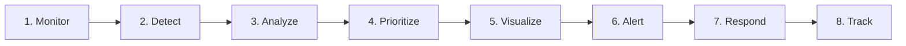

# AI City Command Center

> **Unified Urban Intelligence & Incident Response Platform for City Authorities**  
> *36-Hour Hackathon Project Documentation & Repository Structure*

---

## 1. Project Overview

### Problem Statement
City information is distributed across multiple sources and systems, making it difficult for city authorities to get a unified operational view and respond quickly to urban incidents.

### Selected Solution: AI City Command Center
The **AI City Command Center** is a unified operational platform built for city authorities. It integrates incoming urban data feeds, applies automated incident detection, calculates impact severity through hybrid AI and deterministic logic, visualizes events on an interactive map, dispatches prioritized alerts, and coordinates response actions with real-time status tracking.

---

## 2. Target User

- **Target User**: **City Authorities**
- **Core Challenge**: Overcoming fragmented city information to achieve a unified operational view and respond rapidly to urban incidents.

---

## 3. Core Operational Workflow

The platform operates across an 8-stage operational pipeline:

1. **Monitor**: Ingest incoming urban feeds, reports, and telemetry.
2. **Detect**: Identify anomalies, blockages, or hazard conditions.
3. **Analyze**: AI-assisted assessment of incident type, surrounding conditions, and impact features.
4. **Prioritize**: Combine AI analysis with deterministic rules to assign severity and response priority.
5. **Visualize**: Map geographic coordinates to active city zones on an interactive 2D/3D command interface.
6. **Alert**: Dispatch prioritized alerts and notifications to relevant authorities.
7. **Respond**: Trigger dispatch protocols, coordinate emergency teams, and assign actions.
8. **Track**: Log resolution milestones in real time until the incident is safely resolved.

---

## 4. Scope & Feature Tiers

| Tier | Status | Focus Areas & Features |
| :--- | :---: | :--- |
| **P0: MVP Core** | **Primary Hackathon Target** | 1. Central City Command Overview 2. Incident Detection & Display 3. AI Incident Analysis 4. Severity / Priority Scoring 5. Interactive City Map 6. Alert System 7. Response Tracking |
| **P1: Stretch** | Secondary Hackathon Target | 1. Traffic Intelligence 2. Crowd Intelligence 3. Operational Insights Dashboard 4. 3D Animated Command Center (Three.js / React Three Fiber) |
| **P2: Post-Hackathon** | Planned Enhancement | 1. Historical Analytics & Trends 2. Advanced Predictive Insights 3. Additional Incident Categories 4. Advanced Layered Map Visualizations |
| **P3: Future Vision** | Enterprise Roadmap | 1. Mobile App 2. Full IoT / Hardware Integration 3. Drone Integration 4. Multi-city Enterprise Deployment 5. Autonomous Emergency Dispatch 6. Advanced Predictive City Simulation |

---

## 5. AI Strategy Summary

- **Purpose**: Deliver genuine, functional urban incident intelligence—not cosmetic decoration.
- **Key Capabilities**: Incident/condition detection, incident classification, traffic analysis, crowd analysis, and severity/priority support.
- **Model Selection Status**: **NOT YET LOCKED**. Exact AI model will be selected after a local proof-of-concept. Pretrained models and local inference are preferred where feasible. Training from scratch is excluded.
- **LLM Position**: Large Language Models are **optional and NOT required for P0**.
- **Severity Engine**: Hybrid approach combining AI-supported information with deterministic/rule-based logic.
- **Robust Fallback**: Guaranteed offline fallback utilizing controlled local validated data and a simplified rule-based workflow if AI services experience latency or degradation.

*Detailed documentation: [`docs/04-ai-strategy.md`](./docs/04-ai-strategy.md)*

---

## 6. Architecture & Technology Stack

- **Frontend**: React + Vite, Three.js + React Three Fiber, Drei, Motion.
- **Map Direction**: MapLibre GL JS is the current planned map direction; exact implementation details remain subject to POC/integration feasibility.
- **Backend**: Python + FastAPI.
- **Database**: PostgreSQL is the planned database direction (conceptual schema; no infrastructure provisioned during Phase 0).
- **AI Subsystem**: Python-based AI/ML modular service.
- **Communication**: Conceptual RESTful API endpoints for P0; client-side polling baseline.

*Detailed documentation: [`docs/05-architecture.md`](./docs/05-architecture.md)*

---

## 7. Workstation Distribution & Team Roles

Development is partitioned across four dedicated workstations:

| Workstation | Dedicated Domain | Core Responsibilities |
| :--- | :--- | :--- |
| **Laptop 1** | **AI / ML** | Incident intelligence pipeline, candidate model local POC, local inference, deterministic rule-based fallback workflow. |
| **Laptop 2** | **Backend** | FastAPI application, conceptual REST endpoints, data contracts, business logic, PostgreSQL schema design, AI orchestration. |
| **Laptop 3** | **Supporting & Quality** | Synthetic/sample data pipelines, test suites, mock API data, integration support, and project documentation. |
| **Laptop 4** | **Frontend & 3D Lead** | React + Vite command center, 3D animated environment (R3F/Drei), interactive map layer, alert UI, end-to-end integration and demo lead. |

*Detailed documentation: [`docs/09-team-roles.md`](./docs/09-team-roles.md)*

---

## 8. Current Development Status

> **Current Phase**: **Phase 0 - Project Setup & Architecture Specification**  
> No application code, dependencies, or databases have been created or installed yet. Foundational directory structures, conceptual API contracts, and governance rules are documented to guarantee smooth parallel development during the 36-hour build window.

---

## 9. How Team Members Should Work

1. **Verify Your Baseline**: Pull the latest `main` branch before starting any task.
2. **Consult Shared Contracts**: Check [`docs/06-api-contract.md`](./docs/06-api-contract.md) and [`docs/07-data-schema.md`](./docs/07-data-schema.md) before writing endpoint or data-handling logic.
3. **Branch from Main**: Work in dedicated feature branches named after your workstation (`feat/laptopX-...`).
4. **Verify Fallback Operation**: Ensure your component continues to function smoothly with local validated data.
5. **Protect the 90-Second Demo**: Every commit must advance or protect the core flow specified in [`docs/08-demo-flow.md`](./docs/08-demo-flow.md) (allowed window: 60–90 seconds).
6. **Strictly Abide by**: [`docs/10-development-rules.md`](./docs/10-development-rules.md) and [`CONTRIBUTING.md`](./CONTRIBUTING.md).

---

## 10. Documentation Index

The complete project blueprint is maintained in the `docs/` directory:

| Document | Purpose |
| :--- | :--- |
| [**01. Problem Statement**](./docs/01-problem-statement.md) | Official challenge analysis with Fact / Inference / Recommendation breakdown |
| [**02. Solution Blueprint**](./docs/02-solution.md) | Product architecture, core value proposition, and competitive alternative analysis |
| [**03. MVP Scope Matrix**](./docs/03-mvp-scope.md) | Strict P0/P1/P2/P3 boundaries, success criteria, and risk mitigations |
| [**04. AI Strategy**](./docs/04-ai-strategy.md) | AI role, unlocked model strategy, qualitative evaluation, and deterministic fallbacks |
| [**05. System Architecture**](./docs/05-architecture.md) | End-to-end component topology, data flows, and map technology direction |
| [**06. API Contract**](./docs/06-api-contract.md) | Conceptual REST endpoint specifications, request/response models, and ownership |
| [**07. Data Schema**](./docs/07-data-schema.md) | Conceptual data entities (Incident, Zone, Alert, Response, AI Analysis) |
| [**08. 90-Second Demo Flow**](./docs/08-demo-flow.md) | Step-by-step judge presentation script and failure contingency playbook |
| [**09. Team Roles & Ownership**](./docs/09-team-roles.md) | Workstation allocation (Laptops 1-4) and interface boundaries |
| [**10. Development Rules**](./docs/10-development-rules.md) | Non-negotiable hackathon engineering discipline and workflow guardrails |
