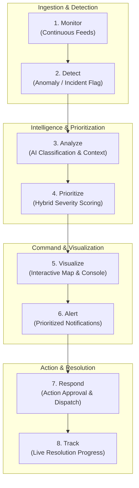

# Document 02: Solution Architecture & Blueprint

> **Project**: AI City Command Center  
> **Status**: Approved Architectural Concept  
> **Target Audience**: Core Team, Technical Mentors, Product Reviewers

---

## 1. Selected Solution: AI City Command Center

The **AI City Command Center** is a consolidated, intelligence-driven operational platform engineered specifically for **City Authorities**. It integrates incoming urban data feeds, applies automated incident detection, calculates impact severity through hybrid AI and deterministic logic, projects actionable events onto an interactive command map, issues targeted alerts, and coordinates multi-agency dispatch with real-time status tracking.

---

## 2. Why This Solution Was Selected

1. **Addresses the Root Problem**: The core problem in city operations is that information is distributed across multiple sources and systems, making it difficult for authorities to get a unified operational view. The Command Center unifies these distributed feeds into a single operational interface.
2. **Action-Oriented Design**: Rather than functioning as a passive dashboard, this solution connects incoming alerts to actionable response decisions and live resolution tracking.
3. **Optimized for City Authorities**: Designed specifically for city authorities who require high-level situational awareness paired with one-click drill-downs.
4. **Feasible within 36 Hours**: A centralized web command console with a Python/FastAPI backend and modular AI service can be reliably built, integrated, and validated within the hackathon timeframe.

---

## 3. Core Operational Workflow

The platform operates across an 8-stage operational pipeline:

### Workflow Stage Breakdown
- **1. Monitor**: Ingests incoming urban data feeds, reports, and telemetry streams.
- **2. Detect**: Evaluates incoming streams against baseline conditions to flag potential incidents.
- **3. Analyze**: Utilizes AI services to classify the incident type, estimate scale, and extract critical features.
- **4. Prioritize**: Calculates an objective severity score by merging AI analysis with deterministic municipal rules (zone sensitivity, priority policies).
- **5. Visualize**: Renders the incident on an interactive map alongside zone boundaries and active municipal units.
- **6. Alert**: Issues immediate visual alerts and structured notifications to relevant authorities.
- **7. Respond**: Provides the operator with suggested response actions and coordinated dispatch plans.
- **8. Track**: Updates incident lifecycle states (`Detected` → `Investigating` → `Dispatched` → `In Progress` → `Resolved`).

---

## 4. Unique Selling Proposition (USP)

1. **Hybrid Deterministic + AI Severity Engine**: Avoids the "black box" risk of pure AI. Combines automated AI classification with transparent, rule-based municipal policy weights (e.g., sensitive zones escalate severity).
2. **End-to-End Action Loop**: Bridges the gap between incident detection and operational resolution tracking on a single screen.
3. **Resilient Dual-Mode Operation**: Backed by a verified deterministic fallback system using controlled local validated data that guarantees uninterrupted command operations even if the AI inference layer is temporarily unavailable or degraded.
4. **Intuitive 2D/3D Situational Clarity**: Delivers immediate visual comprehension of multi-incident city states without cognitive overload.

---

## 5. Alternative Solutions Evaluated & Rejected

| Alternative Solution | Description | Why Rejected |
| :--- | :--- | :--- |
| **Citizen-Facing Mobile Reporting App** | Crowdsourced app for citizens to report civic complaints. | Rejects the core target user (**City Authorities**). Focuses on crowdsourced data entry rather than unified command, triage, and multi-agency response. |
| **Pure Analytical BI Dashboard** | Static historical business intelligence tool showing monthly municipal charts. | Lacks real-time operational response capability. Does not provide active incident detection, immediate alerting, or live dispatch tracking. |
| **Autonomous Dispatch System** | Complete AI-driven dispatch without human oversight. | Unrealistic and dangerous for municipal operations. Urban emergencies require human authority validation ("Human-in-the-Loop"). |
| **End-to-End IoT Hardware Network** | Deploying physical sensors, gateways, and custom hardware. | Infeasible within a 36-hour software hackathon. Focuses effort on hardware debugging rather than intelligent software orchestration. |
