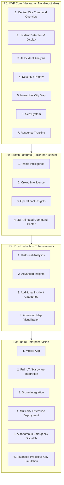

# Document 03: MVP Scope & Feature Hierarchy

> **Project**: AI City Command Center  
> **Status**: Approved Scope Baseline  
> **Target Audience**: All Workstations, Scrum Lead, Mentors

---

## 1. Feature Hierarchy (P0, P1, P2, P3)

To ensure the team delivers a working, stable product within the 36-hour hackathon, all capabilities are partitioned into four strict tiers. **P0 is the non-negotiable hackathon baseline.**

---

## 2. Detailed Scope Breakdown

### P0: MVP Core (Mandatory Hackathon Target)
*Engineering Rule: No developer moves to P1 until all P0 features are integrated and verified.*
1. **Central City Command Overview**: Single-screen operational console providing city authorities with an immediate overview of active city status and incidents.
2. **Incident Detection & Display**: Real-time listing and cards displaying detected urban incidents.
3. **AI Incident Analysis**: Incident/condition detection and classification intelligence providing contextual features and suggested responses.
4. **Severity / Priority**: Hybrid scoring combining AI-supported information with deterministic, rule-based logic.
5. **Interactive City Map**: Geospatial visual component pinning active incidents and city zones.
6. **Alert System**: Contextual alerting for urgent incidents requiring immediate operational attention.
7. **Response Tracking**: Operational state machine tracking incident lifecycle from detection to resolution.

### P1: Stretch Goals (Hackathon Bonus - Only if P0 is 100% Solid)
1. **Traffic Intelligence**: Traffic analysis, speed anomalies, and congestion indicators across major corridors.
2. **Crowd Intelligence**: Crowd density analysis and surge indicators in public spaces.
3. **Operational Insights**: High-level operational metrics and municipal performance insights.
4. **3D Animated Command Center**: Three.js / React Three Fiber / Drei / Motion layer offering a stylized 3D command environment.

### P2: Post-Hackathon Near-Term Scope
1. **Historical Analytics**: Historical incident trends and long-term pattern analysis.
2. **Advanced Insights**: Deep predictive correlations and cross-domain municipal insights.
3. **Additional Incident Categories**: Expansion into specialized urban incident domains.
4. **Advanced Map Visualization**: Advanced geospatial layers, heatmaps, and spatial clustering.

### P3: Future Enterprise Vision
1. **Mobile App**: Mobile client for field responder teams.
2. **Full IoT / Hardware Integration**: Direct integration with physical municipal hardware and edge sensors.
3. **Drone Integration**: Integration with municipal drone fleets for aerial reconnaissance.
4. **Multi-city Enterprise Deployment**: Multi-tenant operational deployment across multiple metropolitan centers.
5. **Autonomous Emergency Dispatch**: Automated unit routing and emergency dispatch coordination.
6. **Advanced Predictive City Simulation**: Digital twin simulation for urban scenario planning.

---

## 3. Explicitly Excluded from MVP (Hackathon Boundaries)

To safeguard against distraction and catastrophic failure, the following are strictly excluded during the 36 hours:
- Training deep learning models from scratch.
- Provisioning physical hardware, microcontrollers, or real sensor networks.
- Implementing production OAuth/SSO or multi-tenant user authentication.
- Building native iOS/Android mobile clients.
- Direct integration with proprietary municipal emergency systems or live external APIs.
- Autonomous dispatch without human operator confirmation.

---

## 4. MVP Success Criteria

The hackathon project will be considered successful if and only if:
1. **End-to-End Operation**: An incident can be detected, analyzed by AI (or fallback), prioritized by severity, visualized on the map, alerted, dispatched, and tracked to resolution.
2. **Demo Reliability**: The approximately 90-second judge demonstration executes cleanly without crashes or unhandled errors.
3. **Dual-Mode Stability**: The application operates smoothly with live services or seamlessly transitions to validated local fallback data if needed.
4. **Genuine Utility**: All displayed intelligence is actionable and directly supports the decision-making of city authorities.

---

## 5. Risks & Fallback Contingency Plan

| # | Identified Risk | Impact | Contingency / Fallback Strategy |
| :-: | :--- | :---: | :--- |
| **1** | **AI Inference Latency or Failure** | Critical | **Deterministic Fallback Engine**: If AI inference exceeds the configured timeout threshold or fails, the backend automatically invokes the simplified rule-based workflow using controlled local validated data. Core command flow never stalls. |
| **2** | **Frontend-Backend Integration Delay** | High | **Strict API Contract & Mock Data**: Laptop 3 maintains schema-identical static JSON fixtures in `data/sample/`. Frontend develops against mock contracts until live endpoints are up. |
| **3** | **Interactive Map / 3D Rendering Lag** | Medium | **Graceful 2D Fallback**: If 3D rendering exhibits performance issues, the UI seamlessly operates on the 2D interactive map view. |
| **4** | **Scope Creep into P1/P2** | Critical | **P0 Freeze Gate**: No branch for P1 is merged until the complete P0 workflow is verified and demo-ready. |
