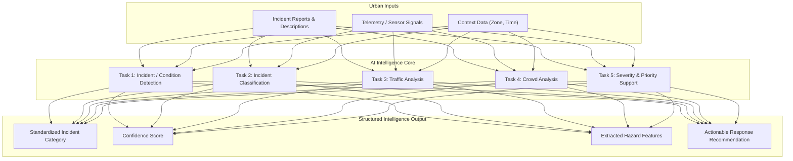
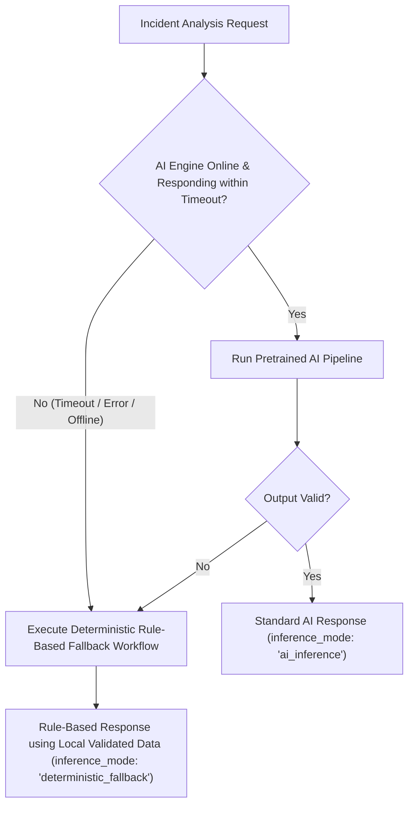

# Document 04: AI Strategy & Intelligence Pipeline

> **Project**: AI City Command Center  
> **Status**: Architecture Approved  
> **Model Status**: **DECISION PENDING / NOT YET LOCKED**  
> **Lead Workstation**: Laptop 1 (AI/ML Lead)

---

## 1. AI Purpose & Philosophy

AI within the AI City Command Center exists exclusively to provide **genuine, functional urban incident intelligence** for city authorities. It is **not** added merely for decoration or superficial augmentation.

Every AI task directly serves one objective: converting fragmented, multi-source urban signals into structured, prioritized, actionable decision support for municipal authorities. The human authority always remains in control ("Human-in-the-Loop").

---

## 2. AI Tasks & Capabilities

The AI subsystem addresses five core analytical tasks:



1. **Incident / Condition Detection**: Detects anomalies and potential urban incidents from incoming data streams.
2. **Incident Classification**: Automatically categorizes detected events into standardized urban incident classes.
3. **Traffic Analysis**: Assesses road congestion levels, corridor disruptions, and traffic impact.
4. **Crowd Analysis**: Evaluates crowd density and flags crowd surge conditions in key public zones.
5. **Severity / Priority Support**: Identifies critical hazard indicators to support the severity scoring engine.

---

## 3. Input & Output Contracts

### Input Schema (to AI Subsystem)
```json
{
  "source_type": "sensor_feed | citizen_report | camera_alert",
  "raw_text": "Heavy congestion and road blockage near Hospital intersection blocking emergency lane",
  "telemetry_metrics": {
    "traffic_speed_drop_percent": 70.0,
    "crowd_density_level": "moderate"
  },
  "zone_id": "ZONE-03",
  "timestamp": "2026-10-06T07:15:00Z"
}
```

### Output Schema (from AI Subsystem)
```json
{
  "detected": true,
  "category": "traffic_collision",
  "confidence": 0.88,
  "extracted_features": {
    "emergency_lane_blocked": true,
    "hazard_level": "high"
  },
  "recommended_response": "dispatch_traffic_control",
  "inference_mode": "ai_inference"
}
```

---

## 4. Model Strategy: Selection Status & Guidelines

> ### ⚠️ CRITICAL NOTICE: EXACT MODEL IS NOT YET LOCKED
> **Exact AI model will be selected after a local proof-of-concept.**  
> Do NOT invent or hard-code a specific model choice at this stage.

### Strategic Guidelines
1. **No Training from Scratch**: Training a deep learning model from scratch is **not the initial strategy**. It is excluded for the 36-hour hackathon.
2. **Pretrained & Local Inference Preferred**: Prioritize pretrained models and local inference where feasible to ensure high availability and eliminate network latency dependencies during the hackathon.
3. **LLM Position**: A Large Language Model (LLM) is **optional, and is NOT required for P0**. Lightweight local models or rule-assisted pipelines are preferred for the core MVP.
4. **Candidate Model Categories (Under POC Evaluation)**:
   - Lightweight pretrained classifier (for text categorization)
   - Embedding-based classifier (for similarity and category matching)
   - Lightweight pretrained computer vision model (evaluated for P1 image/crowd feeds)
   - Rule-assisted intelligence (for deterministic feature validation)
   - Optional language model (evaluated for narrative summarization if feasible, but optional)

---

## 5. Hybrid Severity & Prioritization Logic

Severity is calculated by combining **AI-supported information with deterministic/rule-based logic**:
- AI contributes: condition classification, detected features, and statistical confidence.
- Deterministic logic applies: zone criticality multipliers (e.g., proximity to sensitive areas), municipal priority policies, and active disruption rules.

This ensures transparent, explainable decision-making that city authorities can audit and trust.

---

## 6. Evaluation Criteria (Qualitative)

Rather than arbitrary pre-assigned numerical quotas, candidate models and pipelines are evaluated against practical operational criteria:
1. **Detection & Classification Quality**: Accurate identification of incident types without frequent misclassification.
2. **Consistency**: Uniform and predictable categorization across varying input descriptions.
3. **Responsiveness**: Rapid evaluation suitable for real-time operational triage.
4. **Local Execution Feasibility**: Reliable execution on standard developer hardware without resource exhaustion.
5. **False-Alert Behavior**: Low tendency to trigger spurious alerts from noisy inputs.
6. **Stability**: Rock-solid runtime behavior with zero unexpected crashes or memory leaks.

---

## 7. Failure Handling & Deterministic Fallback

To guarantee that the command center remains operational at all times, the system enforces a strict **Dual-Mode Workflow**:



### Fallback Guarantee
- **Controlled / Local Validated Data**: If AI inference fails, encounters an error, or exceeds the configured timeout threshold, the system immediately switches to a simplified rule-based workflow powered by validated local fixtures in `data/sample/`.
- **Zero Interruption**: The user interface and command console experience zero disruption, ensuring city authorities maintain continuous operational control.
