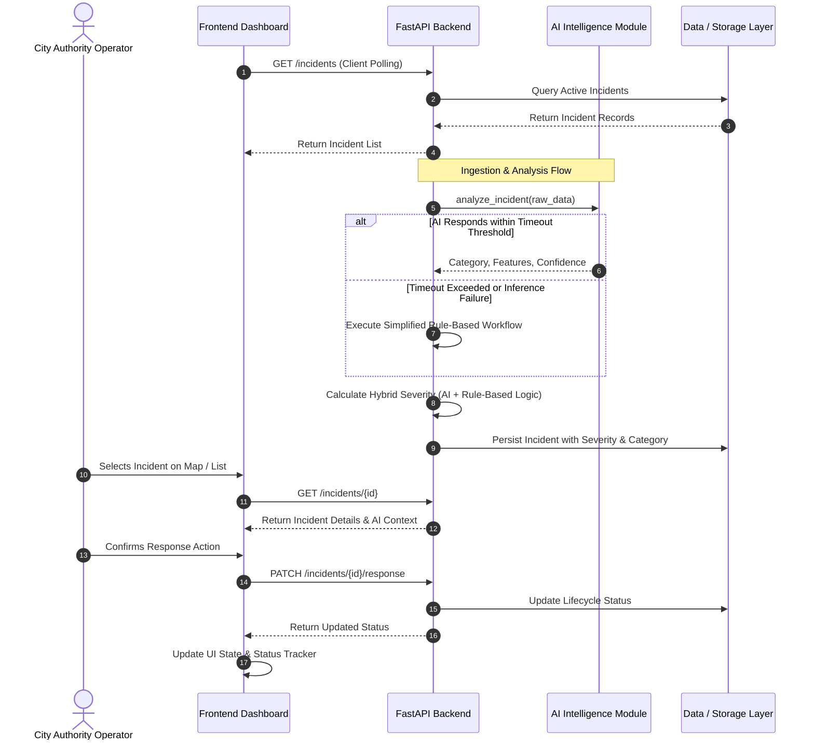

# Document 05: System Architecture & Component Design

> **Project**: AI City Command Center  
> **Status**: Approved Architectural Blueprint  
> **Target Audience**: All Engineering Workstations

---

## 1. High-Level System Architecture

The AI City Command Center is architected as a modular system separating presentation, business logic, intelligence scoring, and data persistence.

```mermaid
flowchart TB
    subgraph CLIENT ["Frontend Presentation Layer (React + Vite)"]
        UI_DASH["Command Center Dashboard<br>(React)"]
        UI_MAP["Interactive Map Component<br>(MapLibre GL JS Planned Direction)"]
        UI_3D["3D Animated Command View<br>(Three.js + R3F + Drei + Motion)"]
        UI_STATE["Client State & Polling Manager"]
    end

    subgraph BACKEND ["Backend API & Orchestration Layer (Python + FastAPI)"]
        API_ROUTER["FastAPI REST Router"]
        SVC_INCIDENT["Incident Management Service"]
        SVC_SEVERITY["Hybrid Priority & Scoring Engine"]
        SVC_ALERT["Alert & Dispatch Service"]
        SVC_ORCH["AI Orchestrator & Fallback Wrapper"]
    end

    subgraph AI_MODULE ["AI Intelligence Subsystem (Python)"]
        AI_PIPE["Detection & Classification Pipeline"]
        AI_FALLBACK["Simplified Rule-Based Fallback Workflow"]
        AI_MODELS["Pretrained Local Model Pipeline"]
    end

    subgraph DATA_TIER ["Data & Persistence Layer"]
        DB_POSTGRES[("PostgreSQL Database<br>(Planned Direction)")]
        DATA_FIXTURES[("Local Sample JSON Fixtures<br>(MVP Baseline & Fallback)")]
    end

    %% Interactions
    UI_DASH & UI_MAP & UI_3D <--> UI_STATE
    UI_STATE <-->|REST HTTP Requests (Polling Baseline)| API_ROUTER

    API_ROUTER --> SVC_INCIDENT & SVC_SEVERITY & SVC_ALERT
    SVC_INCIDENT <--> SVC_ORCH
    SVC_ORCH -->|Internal Python Call| AI_PIPE
    SVC_ORCH -.->|Fallback on Timeout/Error| AI_FALLBACK
    AI_PIPE --> AI_MODELS

    SVC_INCIDENT & SVC_SEVERITY & SVC_ALERT <--> DB_POSTGRES
    SVC_INCIDENT & SVC_SEVERITY & SVC_ALERT -.->|Initial Development Mode| DATA_FIXTURES
```

---

## 2. Component Specifications

### 2.1 Frontend Tier (`frontend/`)
- **Core Framework**: React bundled with Vite for fast local development.
- **Styling & Motion**: Modern styling paired with Motion (`motion`) for fluid transitions, status changes, and alert indicators.
- **3D Command Environment (P1 Stretch)**:
  - Three.js
  - React Three Fiber (`@react-three/fiber`)
  - Drei (`@react-three/drei`)
  - Provides a stylized 3D command center perspective with a seamless toggle back to the 2D view.
- **Interactive Map Direction**:
  - **MapLibre GL JS is the current planned map direction; exact implementation details remain subject to POC/integration feasibility.**
  - Pins active incidents, zone boundaries, and status markers.

### 2.2 Backend Tier (`backend/`)
- **Language & Framework**: Python with FastAPI.
- **Responsibilities**:
  - Expose conceptual REST endpoints (`/health`, `/incidents`, `/incidents/{id}`, `/analysis`, `/alerts`, `/zones`, `/incidents/{id}/response`). Final routing prefix (e.g. `/api` or `/api/v1`) is an implementation detail to be finalized during backend setup.
  - Enforce request validation and response models.
  - Execute the hybrid severity scoring engine merging AI-supported findings with deterministic municipal priority rules.
  - Coordinate AI evaluation calls wrapped with a configurable timeout guard triggering the deterministic fallback workflow.

### 2.3 AI Intelligence Subsystem (`ai/`)
- **Technology**: Python-based AI/ML modular service.
- **Decoupling Strategy**: Exposes a clean Python interface: `analyze_incident(payload: dict) -> dict`.
- **Fault Tolerance**: The AI invocation is guarded by a configurable timeout threshold. If inference exceeds the threshold or encounters an error, the backend immediately invokes the simplified rule-based workflow using controlled local validated data.
- **Model Status**: Exact model will be selected after a local proof-of-concept; pretrained models and local inference are preferred.

### 2.4 Data Tier (`database/` & `data/`)
- **Recommended Database Direction**: **PostgreSQL** is the current planned database direction. Specific extensions (such as spatial indexing) can be evaluated later if actually needed during development.
- **Hackathon Development Mode**: The backend can initially operate against in-memory data structures seeded from validated JSON fixtures in `data/sample/` to unblock parallel frontend and AI work before database integration.

---

## 3. Communication Architecture

- **P0 Baseline**: RESTful HTTP communication with client-side polling. Polling interval is configurable in the client environment.
- **Real-Time Upgrade Path**: WebSocket connections can be evaluated later if real-time streaming notifications are required. Polling remains the reliable baseline.

---

## 4. End-to-End Operational Data Flow


