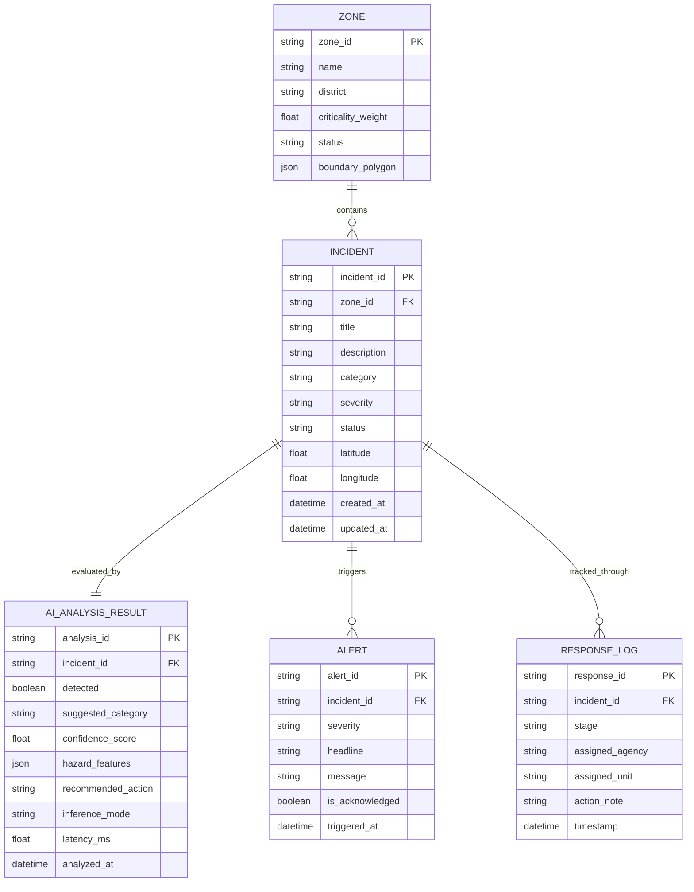

# Document 07: Conceptual Data Schema & Entity Models

> **Project**: AI City Command Center  
> **Status**: Conceptual Specification (Do NOT create production DB yet)  
> **Recommended Database Direction**: PostgreSQL  
> **Lead Owners**: Laptop 2 (Backend) & Laptop 3 (Data & Supporting)

---

## 1. Overview & Data Architecture Principles

This document defines the core domain entities governing the AI City Command Center. To maintain agility during the 36-hour hackathon:
- **Phase 0 & MVP P0**: Data entities may be implemented using in-memory Python structures, Pydantic data schemas, or validated JSON fixtures located in `data/sample/`.
- **Production Roadmap**: Schemas are structured to map directly to relational tables in PostgreSQL with standard primary/foreign key relations.

---

## 2. Entity-Relationship Overview

---

## 3. Conceptual Entity Definitions

### 3.1 Entity: `Incident`
Represents an urban occurrence requiring observation, prioritization, or active municipal intervention.

| Field Name | Type | Constraints / Allowed Values | Description |
| :--- | :--- | :--- | :--- |
| `incident_id` | String | Primary Key, e.g., `INC-2026-001` | Unique system identifier |
| `zone_id` | String | Foreign Key → `Zone.zone_id` | Associated city sector |
| `title` | String | Max 150 chars | Short descriptive incident headline |
| `description` | Text | Optional | Full narrative or raw report context |
| `category` | Enum | `traffic_collision`, `road_hazard`, `crowd_surge`, `fire_emergency`, `utility_failure`, `unclassified` | Standardized category |
| `severity` | Enum | `low`, `medium`, `high`, `critical` | Computed priority tier |
| `status` | Enum | `detected`, `investigating`, `dispatched`, `in_progress`, `resolved` | Operational lifecycle state |
| `latitude` | Float | $-90.0 \le \text{lat} \le 90.0$ | Geospatial latitude coordinate |
| `longitude` | Float | $-180.0 \le \text{lng} \le 180.0$ | Geospatial longitude coordinate |
| `source_type` | Enum | `sensor_stream`, `citizen_report`, `camera_feed`, `manual_operator` | Originating data channel |
| `created_at` | DateTime | ISO-8601 UTC | Timestamp of initial detection |
| `updated_at` | DateTime | ISO-8601 UTC | Timestamp of last status change |

---

### 3.2 Entity: `Zone`
Represents an administrative or geographic partition of the municipality with intrinsic priority weightings.

| Field Name | Type | Constraints / Allowed Values | Description |
| :--- | :--- | :--- | :--- |
| `zone_id` | String | Primary Key, e.g., `ZONE-01` | Unique sector identifier |
| `name` | String | Unique, e.g., "Central Hospital Corridor" | Official sector name |
| `district` | String | Standard administrative district | Municipal administrative parent |
| `criticality_weight` | Float | $0.0 \le \text{weight} \le 1.0$ | Strategic priority multiplier (e.g., 0.95 for hospital corridors) |
| `status` | Enum | `normal`, `elevated_alert`, `critical_hazard` | Overall zone health state |
| `center_latitude`| Float | Valid coordinate | Geographic centroid for map focus |
| `center_longitude`| Float | Valid coordinate | Geographic centroid for map focus |

---

### 3.3 Entity: `AIAnalysisResult`
Encapsulates the structured output generated by the AI subsystem or deterministic fallback engine.

| Field Name | Type | Constraints / Allowed Values | Description |
| :--- | :--- | :--- | :--- |
| `analysis_id` | String | Primary Key, e.g., `ANL-5001` | Unique analysis run identifier |
| `incident_id` | String | Foreign Key → `Incident.incident_id` | Target incident analyzed |
| `detected` | Boolean | True / False | Whether input constitutes a valid incident |
| `suggested_category`| Enum | Standard incident category | Category predicted by intelligence layer |
| `confidence_score` | Float | $0.0 \le \text{conf} \le 1.0$ | Statistical confidence metric |
| `hazard_features` | JSON | Key-value pairs | Extracted tags (e.g., `{"blocked_lanes": 2}`) |
| `recommended_action`| String | Action slug | Suggested standard operating procedure |
| `inference_mode` | Enum | `ai_inference`, `hybrid_fallback`, `deterministic_fallback` | Mode used to produce analysis |
| `latency_ms` | Float | Execution duration | Time taken to evaluate input |
| `analyzed_at` | DateTime | ISO-8601 UTC | Timestamp of analysis completion |

---

### 3.4 Entity: `Alert`
Represents a prioritized, actionable notification pushed to the command console.

| Field Name | Type | Constraints / Allowed Values | Description |
| :--- | :--- | :--- | :--- |
| `alert_id` | String | Primary Key, e.g., `ALT-9001` | Unique alert event identifier |
| `incident_id` | String | Foreign Key → `Incident.incident_id` | Reference incident generating alert |
| `severity` | Enum | `critical`, `high`, `medium` | Urgency rating |
| `headline` | String | Max 120 chars | Concise banner notification text |
| `message` | Text | Explanatory message | Full situational briefing for operator |
| `is_acknowledged` | Boolean | Default: `false` | Acknowledgment status by operator |
| `triggered_at` | DateTime | ISO-8601 UTC | Timestamp alert was raised |

---

### 3.5 Entity: `ResponseLog`
Captures the chronological audit trail of municipal actions dispatched against an incident.

| Field Name | Type | Constraints / Allowed Values | Description |
| :--- | :--- | :--- | :--- |
| `response_id` | String | Primary Key, e.g., `RSP-3001` | Unique response event identifier |
| `incident_id` | String | Foreign Key → `Incident.incident_id` | Associated incident |
| `stage` | Enum | `investigating`, `dispatched`, `in_progress`, `resolved` | Operational lifecycle milestone |
| `assigned_agency`| String | E.g., "Traffic Enforcement", "Fire Service" | Municipal organization in charge |
| `assigned_unit` | String | E.g., "Patrol Car Bravo-2", "Engine 5" | Specific field unit identifier |
| `action_note` | Text | Operational comment | Field notes or operator instructions |
| `timestamp` | DateTime | ISO-8601 UTC | Exact time action was logged |
