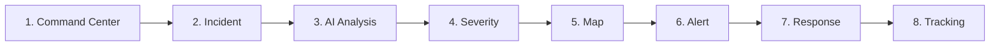

# Document 08: Judge Demo Script & Presentation Flow

> **Project**: AI City Command Center  
> **Target Audience**: Hackathon Judges & Evaluation Mentors  
> **Target Duration**: Approximately 90 seconds (Allowed Window: 60–90 seconds)  
> **Lead Presenters**: Laptop 4 (Frontend UI) & Laptop 1 (AI Context)

---

## 1. Demo Objectives & Guiding Principles

Judges evaluate dozens of projects in rapid succession. This demo script is engineered to prove:
1. **Clear Problem Alignment**: Demonstrates solving fragmented municipal information for city authorities.
2. **Genuine AI Intelligence**: Highlights automated incident classification and feature extraction—not cosmetic decoration.
3. **Complete Operational Loop**: Walks through the full lifecycle in approximately 90 seconds without technical glitches.
4. **Resilience**: Backed by seamless fallback triggers so the presentation never stalls.

---

## 2. Core Demo Sequence (~90 Seconds)

The demonstration follows the exact core workflow:

| Time Window | Operational Stage | Screen Action / Visual Cue | Narration Script |
| :---: | :--- | :--- | :--- |
| **00:00 - 00:15** | **1. Central Command Overview** | Presenter displays the central command overview showing city zones, active incident summary, and system health status. | *"Good afternoon, Judges. This is the AI City Command Center—built for city authorities to overcome fragmented municipal data and achieve a unified operational view."* |
| **00:15 - 00:25** | **2. Incident Detection & Display** | A new incoming incident card appears: an unverified incident report of a road blockage in a high-priority transit corridor. | *"Our detection pipeline surfaces an unverified anomaly, flagged automatically from incoming city feeds."* |
| **00:25 - 00:40** | **3. AI Incident Analysis & 4. Severity Scoring** | Presenter selects the incident. Detail panel shows AI analysis: category identified, hazard features extracted, and high confidence. Severity is escalated to Critical via hybrid logic. | *"Our AI intelligence engine classifies the incident, extracts key hazard indicators, and combines model findings with zone priority rules to establish an urgent Critical severity level."* |
| **00:40 - 00:55** | **5. Interactive Map & 6. Alert System** | Interactive city map pans to the affected zone with an animated alert beacon. High-urgency alert banner highlights the event. | *"On the interactive city map, the affected zone immediately highlights with active alert beacons, giving authorities immediate geospatial clarity."* |
| **00:55 - 01:15** | **7. Response Dispatch** | Operator triggers emergency response action. Suggested response plan is reviewed and approved with one click. | *"Authorities can act immediately: the operator reviews the recommended response action and dispatches response units with a single click."* |
| **01:15 - 01:30** | **8. Response Tracking to Resolution** | Status tracker advances through operational milestones (`Dispatched` $\rightarrow$ `In Progress` $\rightarrow$ `Resolved`). Zone returns to normal status. | *"The response tracker monitors progress in real time through to final resolution. That is unified urban intelligence from detection to resolution in under 90 seconds."* |

---

## 3. Workstation Roles During the Live Demo

- **Laptop 4 (Primary Presentation Screen)**:
  - Runs full-screen browser on the Command Center UI.
  - Controls user interactions (incident selection, map navigation, response dispatch).
- **Laptop 1 (AI Technical Support)**:
  - Ready to explain candidate model selection, feature extraction, and local inference architecture.
- **Laptop 2 & Laptop 3 (System Reliability & Telemetry)**:
  - Ensures local backend and mock fallback data stability.

---

## 4. Contingency & Failsafe Protocols

| Potential Failure Scenario | Immediate Remedy during Live Demo |
| :--- | :--- |
| **Network / Wi-Fi Instability** | The application runs entirely in a local environment. No external internet dependency is required for the demo. |
| **AI Inference Latency or Failure** | The backend automatically triggers the simplified rule-based workflow using local validated data. Presenter continues seamlessly. |
| **Map Tile Rendering Lag** | Cached map tiles and fallbacks render immediately. |
| **Accidental Browser Refresh** | Frontend state reloads immediately from local seed data without breaking the demo sequence. |
