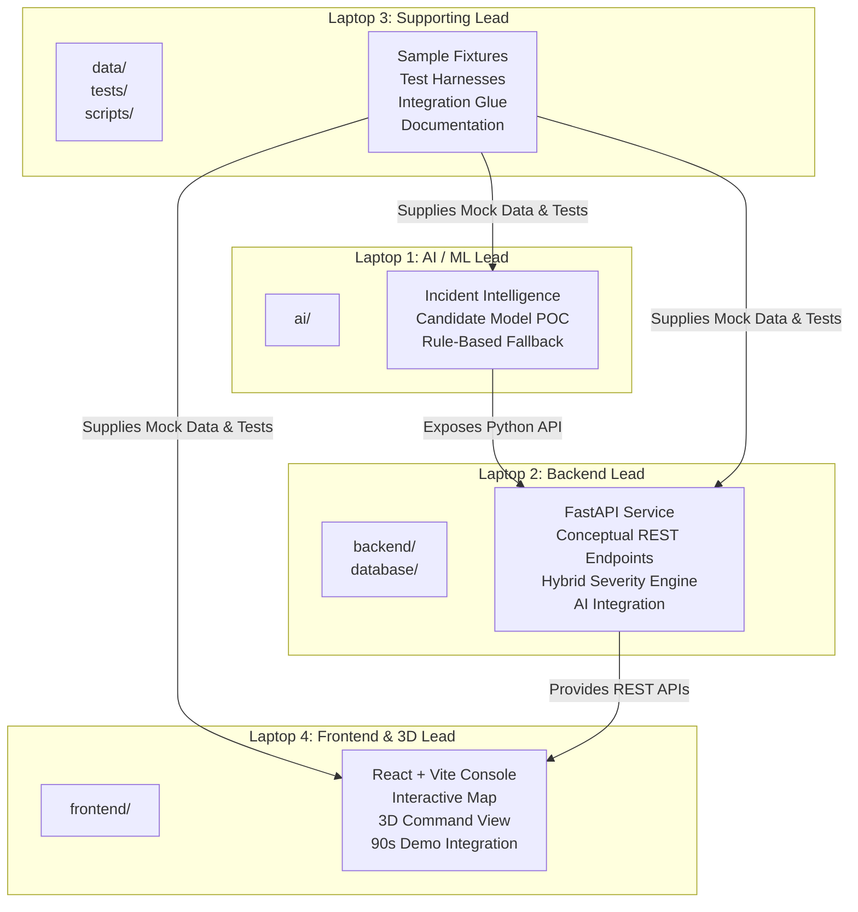

# Document 09: Team Workstation Roles & Operational Boundaries

> **Project**: AI City Command Center  
> **Structure**: 4-Workstation Distributed Hackathon Setup  
> **Objective**: Clear ownership, parallel velocity, protected demo flow

---

## 1. Workstation Allocation Matrix

To prevent file collision and eliminate confusion during the 36-hour sprint, code ownership is strictly partitioned by directory and responsibility:

---

## 2. Detailed Workstation Mandates

### Laptop 1: AI / Machine Learning Lead
- **Primary Domain**: Directory `ai/`
- **Key Responsibilities**:
  1. Conduct local proof-of-concept across candidate model categories (lightweight pretrained classifier, embedding classifier, rule-assisted intelligence; LLM optional).
  2. Implement local inference pipeline with standardized input/output schemas.
  3. Author the deterministic fallback rule engine in `ai/` using controlled local validated data.
  4. Ensure inference meets operational responsiveness without resource exhaustion.
  5. Support the hybrid severity calculation with extracted features and confidence metrics.
- **Handoff Boundary**: Exposes a clean Python callable interface to Laptop 2:
  `analyze_incident(payload: dict) -> dict`.

---

### Laptop 2: Backend Architecture Lead
- **Primary Domain**: Directories `backend/` and `database/`
- **Key Responsibilities**:
  1. Implement FastAPI application and route controllers defined in [`docs/06-api-contract.md`](./06-api-contract.md).
  2. Implement data validation schemas mirroring [`docs/07-data-schema.md`](./07-data-schema.md).
  3. Build the hybrid severity scoring engine merging AI results with deterministic municipal rules.
  4. Coordinate calls to Laptop 1's AI engine with a configurable timeout guard triggering the deterministic fallback.
  5. Maintain in-memory or database repositories for incidents, zones, alerts, and response tracking.
- **Handoff Boundary**: Exposes clean, documented REST API endpoints to Laptop 4.

---

### Laptop 3: Supporting, Data, Testing & Integration Lead
- **Primary Domain**: Directories `data/`, `tests/`, `scripts/`, and root documentation maintenance
- **Key Responsibilities**:
  1. Generate realistic synthetic data fixtures for raw, processed, and sample incidents in `data/sample/`.
  2. Author automated test harnesses in `tests/backend/`, `tests/frontend/`, and `tests/ai/`.
  3. Maintain mock API responses so Laptop 4 can build the UI before live backend endpoints are completed.
  4. Verify schema consistency between API contracts, data models, and frontend types.
  5. Support team integration, monitor test runs, and maintain documentation alignment.
- **Handoff Boundary**: Supplies verified fixtures, mock data, and test harnesses to all workstations.

---

### Laptop 4: Frontend, 3D Experience & Demo Integration Lead
- **Primary Domain**: Directory `frontend/`
- **Key Responsibilities**:
  1. Scaffold and develop the React + Vite Command Center user interface.
  2. Implement the central command overview with active KPI cards and incident listings.
  3. Implement the interactive map component (MapLibre GL JS planned direction) displaying city zones, incident pins, and alert beacons.
  4. Develop the P1 3D Command View (Three.js / React Three Fiber / Drei / Motion) with seamless toggle to 2D view.
  5. Connect frontend state to backend REST endpoints with client polling and robust error boundaries.
  6. Direct and orchestrate the live approximately 90-second judge demonstration.
- **Handoff Boundary**: Delivers the user-facing operational experience and leads demo execution.

---

## 3. Team Collaboration & Alignment Points

The team maintains regular coordination to ensure integration stability:
- **Phase 1 Alignment**: Confirm conceptual API contracts and deliver initial sample JSON fixtures.
- **Internal Mock Run**: Laptop 4 validates UI against mock fixtures; Laptop 1 validates AI pipeline against sample data.
- **Live Integration**: Laptop 4 connects to Laptop 2's live backend; Laptop 2 connects to Laptop 1's AI module.
- **Demo Rehearsal**: End-to-end rehearsal of the approximately 90-second judge demonstration.
