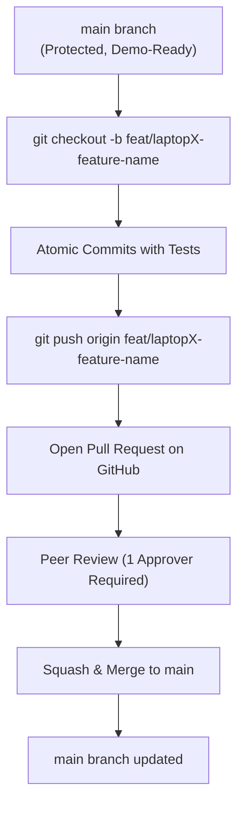

# Document 10: Development Rules & Engineering Guardrails

> **Project**: AI City Command Center  
> **Status**: Mandatory Protocol for All Team Members  
> **Applicability**: Entire 36-Hour Hackathon Lifecycle

---

## 1. Core Engineering Principles

These twelve rules are absolute. They exist to eliminate chaos, safeguard product quality, and ensure the team delivers a compelling, glitch-free presentation to the judges.

---

### Rule 1: P0 Before P1 (Always)
No team member may start work on P1 stretch goals (3D command view, traffic analytics, crowd anomaly layers) until all seven P0 features are fully functional, integrated, and verified end-to-end. If a P0 bug is discovered, all P1 development pauses immediately.

### Rule 2: Absolute Ban on Scope Creep
Reject unplanned features, gratuitous third-party libraries, and speculative functionality. If a feature is not explicitly documented in [`docs/03-mvp-scope.md`](./03-mvp-scope.md), it will not be built.

### Rule 3: Zero Random Dependencies
Do not run `npm install <random-pkg>` or `pip install <random-pkg>` on a whim. Every dependency increases package resolution time, potential version conflicts, and build failure risks. Any new dependency must be cleared with the workstation lead and Laptop 3.

### Rule 4: No Unilateral API Contract Changes
[`docs/06-api-contract.md`](./06-api-contract.md) is our operational binding agreement. Neither Backend (Laptop 2) nor Frontend (Laptop 4) may alter endpoint routes, parameter names, or JSON keys without an explicit sync meeting and mutual consent.

### Rule 5: Zero Hardcoded Secrets
API keys, credentials, tokens, or environment-specific IP addresses must never be written into source code. Always reference environment variables via `.env`.

### Rule 6: Never Commit `.env` Files
The `.env` file must remain strictly local. Only `.env.example` may be tracked in Git. Committing credentials to GitHub risks disqualification, security revocation, and environment mismatch.

### Rule 7: Test Before Merging
Every feature branch must undergo a local sanity run before opening a Pull Request:
- Frontend: Must build cleanly without TypeScript/JSX syntax errors (`npm run build`).
- Backend: Must boot without import errors and pass health checks.
- AI Module: Must execute on test fixtures without memory overflows.

### Rule 8: Pull Latest Changes Before Starting Any Work
Before beginning any coding session or feature branch, execute:
```bash
git checkout main
git pull origin main
```
Never branch from an outdated commit.

### Rule 9: Small, Meaningful Commits
Do not hoard changes for hours and push a massive multi-hundred-line commit. Make atomic commits reflecting discrete achievements (e.g., "Add incident card component", "Wire mock severity calculation").

### Rule 10: Clear, Professional Commit Messages
Use standardized commit prefixes:
- `feat(scope): ...` for new capabilities.
- `fix(scope): ...` for bug fixes.
- `docs(scope): ...` for documentation changes.
- `test(scope): ...` for test additions.
- `refactor(scope): ...` for non-behavioral code cleanup.

### Rule 11: Respect Workstation Domain Boundaries
Do not edit files in another developer's core directory without prior coordination:
- Laptop 1 owns `ai/`
- Laptop 2 owns `backend/` and `database/`
- Laptop 3 owns `data/`, `tests/`, `scripts/`
- Laptop 4 owns `frontend/`

### Rule 12: Keep Fallback Working & Never Break the P0 Demo Flow
Every AI-assisted or network-dependent feature must maintain a working, instantaneous deterministic fallback. If an external service or ML model is unavailable, the application must automatically switch to local fallback data without crashing or showing error dialogs. The 90-second judge demo flow must remain protected at all costs.

---

## 2. GitHub Team Workflow Standard



1. **GitHub is the Single Source of Truth**: All code must reside in the official GitHub repository.
2. **Branch Naming**: Format as `feat/laptop<N>-<name>` or `fix/laptop<N>-<name>`.
3. **No Direct Pushes to `main`**: All updates pass through a Pull Request with at least one peer approval.
4. **Experimental Work Stays in Branches**: If a feature is unstable at deadline time, do not merge it. The `main` branch must remain continuously demo-ready.
